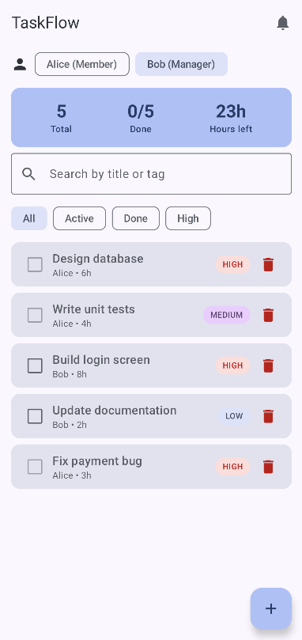
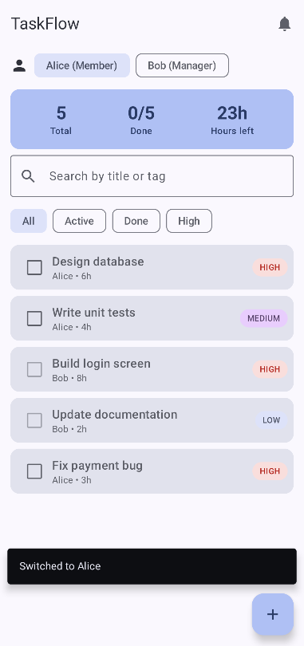
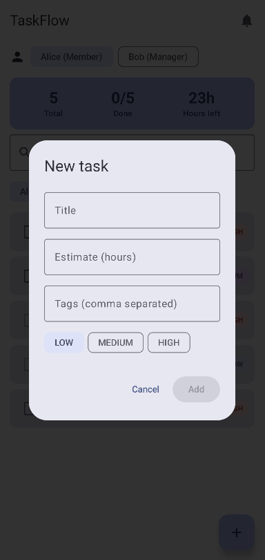

# TaskFlow (Android)

TaskFlow is a small task manager for Android built with **Kotlin, Jetpack Compose, Material 3 and ViewModel**.
It continues the console project from HW1: the `Task` data class, `Priority`, the sealed class `TaskResult`
and the `User` / `Manager` inheritance are reused, and the logic from `TaskManager` now lives in a `ViewModel`.

# Screens

| Manager screen | Member screen | Add task screen |
|---|---|---|
|  |  |  |

## Features

- List of tasks with priority badges, assignee, estimate and tags (tap a card to expand it)
- Add a task (dialog with title, hours, tags and priority)
- Mark a task as done with a checkbox
- Delete a task (only the **Manager** user is allowed; **Alice** gets a message)
- Search by title or tag and filter chips (All / Active / Done / High)
- Statistics card: total tasks, done tasks and remaining hours
- "Send reminders" button in the top bar (suspend function + coroutine in `viewModelScope`)
- **State Lab** tab: three counters that show the difference between `remember`, `rememberSaveable` and `ViewModel`

## How to run

1. Install **Android Studio** (Koala or newer). It brings its own JDK, Gradle and SDK downloader.
2. `File -> Open` and choose the `taskflow-android` folder (the one with `settings.gradle.kts`).
3. Wait for the Gradle sync to finish (the first time it downloads dependencies). Install the
   Android SDK Platform 34 if Android Studio asks for it.
4. Create an emulator in Device Manager (any phone, API 24+) or connect a real device with USB debugging.
5. Press **Run** (green triangle) with the `app` configuration.

## Where the requirements are demonstrated

| Requirement | Where |
|---|---|
| Kotlin + Compose + Material 3 | `ui/` package, `ui/theme/Theme.kt` (dynamic color on Android 12+) |
| 3+ reusable Composables | `ui/components/Components.kt`: `PriorityBadge`, `TaskCard`, `StatsCard`, `SearchField`, `FilterRow`, `UserSwitcher`, `AddTaskDialog` |
| `Row`, `Column`, `Box` | `Row`/`Column` in `TaskCard`, `StatsCard`, screens; `Box` in `PriorityBadge` and the empty-list message |
| `LazyColumn`, `Card`, `Text`, `Icon` | `TaskListScreen` (`LazyColumn`), `TaskCard` / `StatsCard` (`Card`), icons from Material Icons |
| 2+ interactions | add task, complete task, delete task, search, filter, switch user, send reminders |
| `TextField`, `Button`, `Checkbox` | `SearchField`, `AddTaskDialog` (`OutlinedTextField`, `Button`), `TaskCard` (`Checkbox`) |
| UI updates after actions | UI reads `viewModel.uiState`; every change creates a new state and Compose recomposes |
| `remember` / `rememberSaveable` | `TaskCard` (`expanded`), `AddTaskDialog` (text fields), `TaskFlowApp` (selected tab, dialog flag), `StateLabScreen` |
| ViewModel | `viewmodel/TaskViewModel.kt` |
| UI separated from state | screens are stateless: they receive `TaskUiState` and callbacks, logic is in `TaskViewModel` |
| Kotlin features from HW1 | data class `Task`, sealed class `TaskResult`, inheritance `User`/`Manager`, `filter`/`map`/`reduce` in `TaskUiState`, suspend function `sendReminders` |

## remember vs rememberSaveable vs ViewModel

| | Rotation | Process death | Typical use |
|---|---|---|---|
| `remember` | lost | lost | short-lived UI state inside a composable (expanded/collapsed) |
| `rememberSaveable` | kept | kept (small, Bundle-compatible data) | text being typed, selected tab, dialog open flag |
| `ViewModel` | kept | lost | screen state and business logic (task list, filter, search) |

`remember` only keeps a value while the composable stays in the composition; rotation recreates the Activity and the
composition, so the value is lost. `rememberSaveable` additionally writes the value to the saved instance state.
A `ViewModel` is stored outside the Activity, so it survives configuration changes, but it is destroyed when the
user leaves the screen for good or the system kills the process.

## Project structure

```
app/src/main/java/com/example/taskflow/
  MainActivity.kt
  model/Models.kt            Task, Priority, TaskResult, User, Manager
  viewmodel/TaskViewModel.kt TaskViewModel, TaskUiState, TaskFilter
  ui/TaskFlowApp.kt          Scaffold, navigation bar, snackbar, dialog
  ui/components/             reusable composables
  ui/screens/                TaskListScreen
  ui/theme/Theme.kt
```
