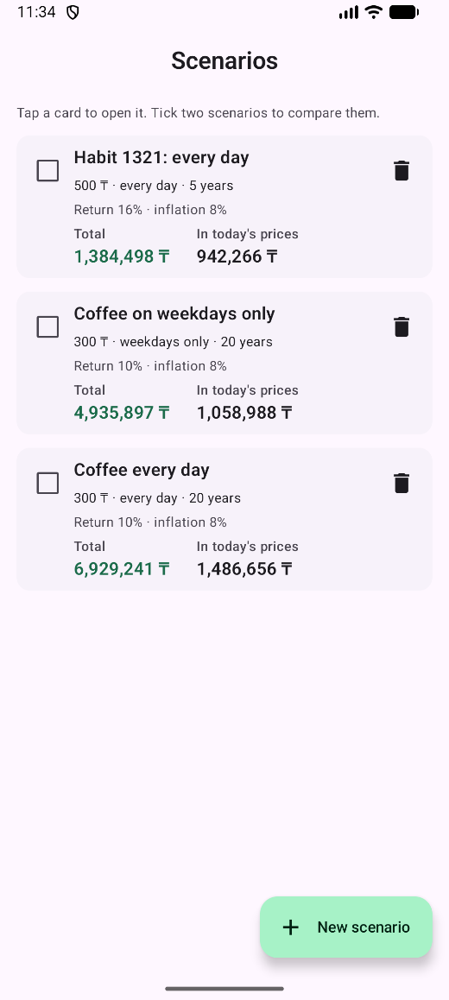
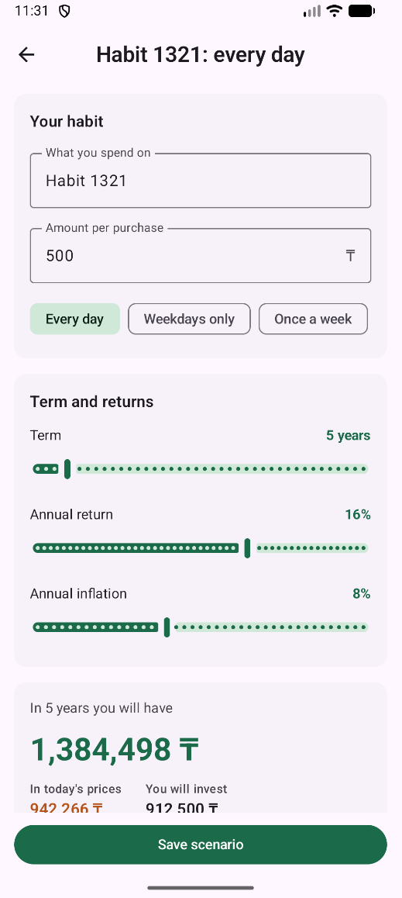
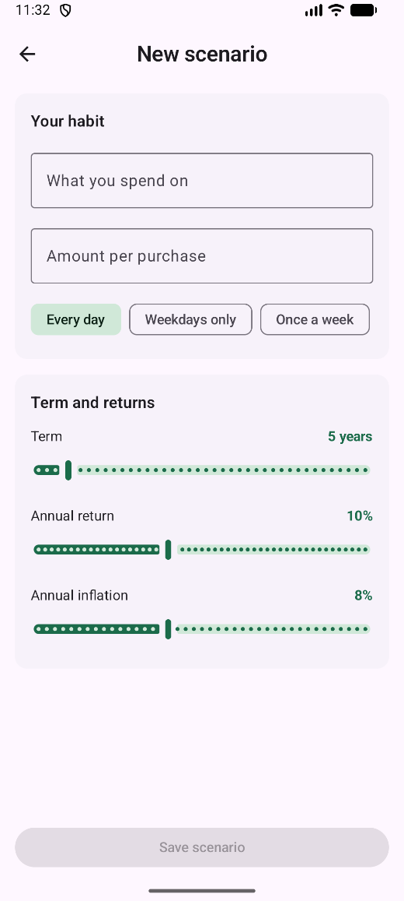
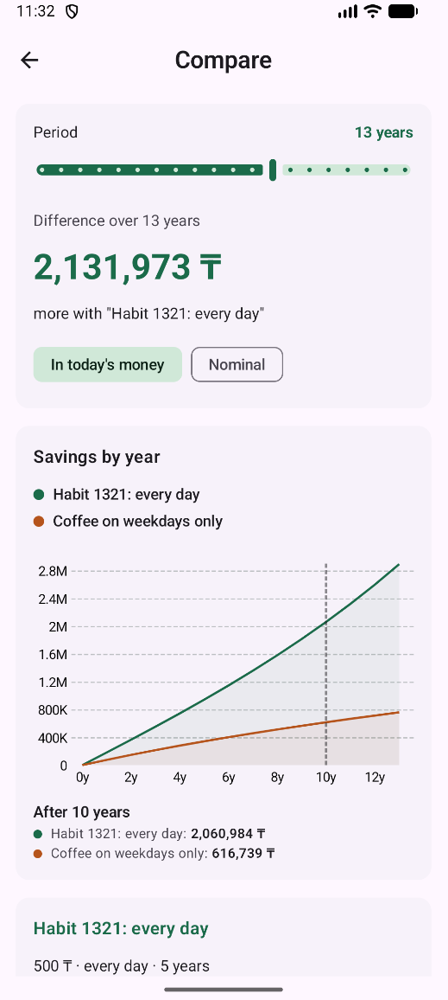

# What If

The app that shows what a small recurring expense would become if you invested it instead. It plots two lines: the account balance (nominal) and its value in today's prices (adjusted for inflation).

Jetpack Compose + Material 3, Navigation Compose, Vico 2.1.3 (charts).

## Features

- **Constructor.** Enter a habit (e.g. coffee), the amount and how often you spend on it (every day, weekdays, weekly). Set the term (1-40 years), annual return and annual inflation. The result and the chart appear once the habit and amount are filled in and update live.
- **Interactive chart.** Built with the [Vico](https://github.com/patrykandpatrick/vico) charting library. Touch or drag across it to read the amounts for any year.
- **Saved scenarios.** Save, reopen, edit and delete scenarios. They are stored locally and survive app restarts. Two demo scenarios are added on the first launch.
- **Comparison.** Select two scenarios and compare them on one chart: the difference in money, a nominal / real toggle and a slider for the comparison period.

## Screens

| Scenarios screen | Constructor screen | New scenario screen | Compare scenarios screen |
|---|---|---|---|
|  |  |  |  |

## Navigation

| Screen | Route class | Purpose |
|---|---|---|
| Scenarios (start) | `Scenarios` | List of saved scenarios. Tap a card to open it, tick two to compare. |
| Constructor | `Constructor(scenarioId: Long = 0)` | Create (id 0) or edit a scenario with a live chart. |
| Compare | `Compare(idA: Long, idB: Long)` | Chart and difference of two scenarios. |

## App flow

```
Scenarios (start)
 ├── tap a card / "New scenario" ──► Constructor(scenarioId)
 └── select two scenarios ────────► Compare(idA, idB)
```

## Architecture

```
models/        Data classes: Scenario, ProjectionParams, ProjectionPoint, Frequency, Comparison
repository/    ScenarioRepository interface + SharedPreferences (JSON) implementation
calculators/   Pure calculation logic (ProjectionCalculator, ComparisonCalculator)
viewmodels/    ConstructorViewModel, ScenariosViewModel, CompareViewModel (+ UI state classes)
ui/
  screens/     ConstructorScreen, ScenariosScreen, CompareScreen
  components/  Reusable composables (ProjectionChart, LabeledSlider, NumberField, cards)
  theme/       Material 3 color schemes
navigation/    Route classes and NavHost
util/          Formatting helpers
```

- One ViewModel per screen, exposing `StateFlow` collected with `collectAsStateWithLifecycle()`.
- ViewModels get the repository from `WhatIfApplication` through a `viewModelFactory`; the repository exposes its data as a read-only `StateFlow`.
- Calculations run on `Dispatchers.Default` (`combine`, `mapLatest`, `flowOn`); one-off events use `Channel`.
- Stateless components (`ProjectionChart`, `LabeledSlider`, `NumberField`) follow state hoisting.
- Local UI state (selected chart point, dialogs, text fields, chip choice) uses `rememberSaveable` and survives rotation.

Formula, with monthly contribution `P`, monthly rate `r` and `n` months:
`FV = P * ((1 + r)^n - 1) / r`, and real value = `FV / (1 + inflation)^years`.

Returns are an assumption set by the user, not a guarantee.

## Running

Requirements: Android Studio, Android SDK 35, JDK 17 (bundled with Android Studio).

1. Open the project folder in Android Studio and wait for Gradle sync.
2. Select an emulator or a connected device.
3. Click **Run**.
